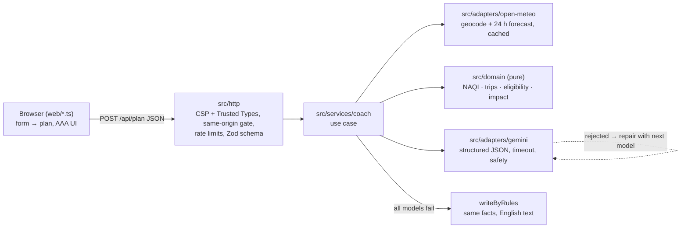

# HazeGuard: a smog-season plan for your home and neighbourhood

HazeGuard is a Gemini-powered assistant for families and communities living through severe winter smog. It reads the live air forecast for your place, then gives you:

- **cleaner trips**: a better time and a lower-emission way to make each regular journey;
- **indoor air fixes**, room by room, chosen for your home;
- **sustainable alternatives** for cooking, heating and getting around;
- **a notice for your residents' group, school or workplace**.

Every choice comes with its direct impact: kilograms of CO₂ saved a week, and how much less PM2.5 your lungs take in.

**Live demo:** https://hazeguard-blush.vercel.app · **Stack:** TypeScript, Hono, Gemini (`@google/genai`), Open-Meteo, Vitest

---

## Chosen vertical

**Challenge 6: AirWise. Navigating winter smog and urban air pollution.**

> Create a GenAI-powered assistant that helps families and communities navigate severe winter smog and urban air pollution: low-emission daily routines, indoor air quality hacks and sustainable alternatives tailored to their location and lifestyle, while clearly explaining the direct impact of their choices.

The persona is an Indian household in November. A parent does the school run by car, a grandparent with COPD lives with them, they cook on LPG, and they sometimes light an angithi. The same family also sits on a residents' welfare association or school parents' group that wants to act together.

## Approach and logic

Two halves. **HazeGuard computes every number. Gemini writes only words.**

1. **Facts first, in pure TypeScript** (`src/domain`, no I/O, 100% tested):
   - **Air:** live hourly PM2.5 and PM10 from Open-Meteo (Copernicus CAMS) are turned into India's **National Air Quality Index** using the CPCB breakpoints. HazeGuard finds the worst hour, the cleanest hour, the best daytime hour to air the home, and how many hours are Poor or worse.
   - **Trips:** each regular trip is priced in **kg CO₂e** (DESNZ/DEFRA 2025 conversion factors) and in **µg of PM2.5 inhaled**. The dose is outdoor PM2.5 × in-mode exposure ratio × breathing rate × time, using the breathing rates in the US EPA Exposure Factors Handbook. HazeGuard then searches nearby hours and realistic modes (walk ≤ 2 km, cycle ≤ 8 km, the bus or metro you have nearby, carpooling) for the lowest-carbon option at the cleanest hour. **Sensitive members are never sent out to walk or cycle when the air is Poor or worse**, because breathing hard multiplies the dose; the plan says so.
   - **Actions:** a **vetted catalogue of 24 actions** is filtered by rules. The rules look at who lives at home, cooking fuel, heating, purifier, smoking, outdoor work, the forecast and whether a community is involved.
2. **Words second, from Gemini** (`src/services`):
   - **What Gemini gets:** the computed facts as JSON and the list of eligible action ids.
   - **What it writes:** it picks 3 to 8 actions, explains _why each matters for this household_, writes a summary, and for communities writes a notice.
   - **Structured output:** Gemini's JSON Schema is generated from the Zod schema, so the two cannot drift apart.
   - **Checks on every reply:** a reply is rejected if it invents an action id, repeats one, misses a required notice, or **contains any digit in any script**. A rejected reply goes to the next model with the reasons ("repair prompt").
   - **Fallback:** if every model fails, the rules write the plan, and the numbers stay identical.
3. **Safety around the model:**
   - The optional free-text note is screened for instruction-like text. If flagged, it is dropped and the user is told; otherwise it is fenced as `<household_note>` data.
   - Safety settings block harmful content.
   - The model is told never to give medical doses.

## How the solution works



| Step | What happens                                                                                                                                                                                                                                   | Where                                                      |
| ---- | ---------------------------------------------------------------------------------------------------------------------------------------------------------------------------------------------------------------------------------------------- | ---------------------------------------------------------- |
| 1    | The user types a city or taps **Use my current location**, ticks who lives at home, describes the home, adds up to five trips and chooses household or community                                                                               | `public/index.html`, `web/form-*.ts`, `web/trip-rows.ts`   |
| 2    | The browser posts JSON; the server checks origin, rate limits, size and every field                                                                                                                                                            | `src/http/security.ts`, `rate-limit.ts`, `plan-request.ts` |
| 3    | Open-Meteo geocodes the place and returns the next 24 hours of PM2.5 and PM10 (cached for 20 minutes)                                                                                                                                          | `src/adapters/open-meteo.ts`                               |
| 4    | The domain computes the NAQI outlook, trip alternatives, eligible actions and the weekly impact                                                                                                                                                | `src/domain/*.ts`                                          |
| 5    | Gemini chooses and explains actions in English or Hindi; the reply is validated and repaired if needed                                                                                                                                         | `src/services/coach.ts`, `brief.ts`, `tailoring.ts`        |
| 6    | The page shows the air now and a 24-hour strip and table, the impact figures, the trip table with reasons in words, a room-by-room checklist (ticks are saved), the community notice (copy or print) and **How these numbers were worked out** | `web/render-*.ts`                                          |

### Problem statement alignment

| #   | Phrase in the brief                                   | What HazeGuard does                                                                                                                                                         | Where in the UI                                                | Code                                                              | Tests                                                   |
| --- | ----------------------------------------------------- | --------------------------------------------------------------------------------------------------------------------------------------------------------------------------- | -------------------------------------------------------------- | ----------------------------------------------------------------- | ------------------------------------------------------- |
| C1  | GenAI-powered assistant                               | Gemini structured output with a three-model chain, repair prompts and rule fallback                                                                                         | Summary, "why" lines, notice                                   | `services/coach.ts`, `adapters/gemini.ts`                         | `coach.test.ts`, `test/live/gemini.eval.ts`             |
| C2  | families                                              | Members (children, over-60s, lung or heart disease, pregnancy, outdoor work) change the actions and the trip choices                                                        | "Who lives at home"                                            | `domain/household.ts`, `eligibility.ts`                           | `eligibility.test.ts`, `trips.test.ts`                  |
| C3  | communities                                           | Residents' association, school or workplace mode: community actions, a copyable notice and impact scaled by headcount                                                       | "Who the plan is for", Notice card                             | `domain/actions-community.ts`, `web/render-notice.ts`             | `tailoring.test.ts`, `render.test.ts`                   |
| C4  | severe winter smog and urban air pollution            | Live PM2.5/PM10 → India's NAQI with CPCB health messages; worst and cleanest hours, hours at Poor or worse                                                                  | Air card, 24-hour strip and table                              | `domain/aqi.ts`, `forecast.ts`, `adapters/open-meteo.ts`          | `aqi.test.ts`, `forecast.test.ts`, `open-meteo.test.ts` |
| C5  | low-emission daily routines                           | Each regular trip moved to the cleanest nearby hour and the lowest-carbon realistic mode                                                                                    | Cleaner trips table                                            | `domain/trips.ts`                                                 | `trips.test.ts`                                         |
| C6  | indoor air quality hacks                              | Clean room, fan filter, closed-room purifier use, airing at the cleanest hour, exhaust while cooking, wet mopping, sealing gaps                                             | Room-by-room checklist                                         | `domain/actions-home.ts`                                          | `eligibility.test.ts`                                   |
| C7  | sustainable alternatives                              | Metro, bus, carpool, cycling and walking; LPG, piped gas or induction instead of biomass; electric heating instead of fuel heaters                                          | Trips table, checklist                                         | `domain/trips.ts`, `actions-home.ts`                              | `trips.test.ts`, `eligibility.test.ts`                  |
| C8  | tailored to their location and lifestyle              | Typed place or browser location; members, fuel, heating, purifier, smoking, trips, nearby transit, timing flexibility; English or Hindi                                     | Whole form                                                     | `http/plan-request.ts`, `web/form-read.ts`                        | `units.test.ts`, `form.test.ts`                         |
| C9  | clearly explaining the direct impact of their choices | kg CO₂ a week, PM2.5 µg breathed and % change (including when active travel raises it), community-scaled CO₂, a reason in words for every change, formulas and factor table | Impact card, trip reasons, "How these numbers were worked out" | `domain/assessment.ts`, `web/render-trips.ts`, `render-method.ts` | `assessment.test.ts`, `render.test.ts`                  |

## Assumptions made

- **Air data and scale:**
  - Open-Meteo's CAMS forecast is a fair stand-in for street-level air.
  - Hourly readings are placed on the CPCB scale, which is defined for 24-hour averages, so the index is **indicative**.
  - Above the Severe breakpoint the index is capped at 500.
- **Emission factors:** CO₂e factors are DESNZ/DEFRA 2025 passenger-km values, a sourced proxy for Indian vehicles. A carpool is a car shared by three people.
- **Trip estimates:**
  - Breathing rates come from the US EPA Exposure Factors Handbook (2011).
  - In-vehicle exposure ratios and door-to-door speeds are typical city estimates. They are listed in the app and in [PROBLEM_ALIGNMENT.md](PROBLEM_ALIGNMENT.md).
  - If anyone at home is sensitive, trips are treated as possibly made by them.
- **What the model sees:**
  - Gemini never sees names or contact details: the form asks for none, and the note's hint says not to add any.
  - The only free text is an optional 280-character note.
- **Hindi:** Hindi plans are written by Gemini. If every model is unavailable, the rules write the plan in English and the page says so.

## Evaluation criteria

| Criterion         | Evidence                                                                                                                                                                                                                                                               | Document                                     |
| ----------------- | ---------------------------------------------------------------------------------------------------------------------------------------------------------------------------------------------------------------------------------------------------------------------- | -------------------------------------------- |
| Code quality      | Ports-and-adapters layers enforced by tests. Strict TypeScript (`exactOptionalPropertyTypes`, `noUncheckedIndexedAccess`). ESLint `strictTypeChecked` + SonarJS + limits of 30 lines per function, 3 parameters, complexity 8 and 200 lines per module. 0% duplication | [CODE_QUALITY.md](CODE_QUALITY.md)           |
| Security          | Strict CSP with Trusted Types, same-origin gate, two-level rate limits, Zod strict schemas, Trojan Source filter, digit-free and catalogue-bound model output, injection screen, secret masking, gitleaks, CodeQL, distroless image                                    | [SECURITY.md](SECURITY.md)                   |
| Efficiency        | About 11 KB (Brotli) for a first visit across 5 requests. Hashed bundles cached for a year. Precompressed in-memory assets. Cached forecasts and geocodes. One model call in the common case                                                                           | [EFFICIENCY.md](EFFICIENCY.md)               |
| Testing           | 434 Vitest tests at 100% statements, branches, functions and lines. Real-page jsdom tests with axe-core. Contrast arithmetic. Live Gemini eval                                                                                                                         | [TESTING.md](TESTING.md)                     |
| Accessibility     | WCAG 2.2 AAA contrast (7:1) in light and dark modes. Error summary with links. Live regions. 44 px targets. Real tables for every chart. `lang` on Hindi text. Reduced motion. Print stylesheet                                                                        | [ACCESSIBILITY.md](ACCESSIBILITY.md)         |
| Problem alignment | Every phrase of the brief mapped to UI, code and tests (C1 to C9 above), with sourced numbers                                                                                                                                                                          | [PROBLEM_ALIGNMENT.md](PROBLEM_ALIGNMENT.md) |

## Run it

```bash
npm ci
cp .env.example .env      # add GEMINI_API_KEY (optional: without it the rules write the text)
npm run dev               # builds, then serves http://localhost:8080
npm run check             # lint + typecheck + 434 tests at 100% coverage + build
npm run eval              # two live Gemini scenarios (uses the key in .env)
```

**Deploy:**

- **Vercel:** `vercel.json` routes every path through `api/index.js`, so the app's own headers apply. Set `GEMINI_API_KEY` as a sensitive variable, and set `TRUSTED_PROXIES=1`.
- **Containers:** use the distroless `Dockerfile`.

## Project layout

```text
src/domain     pure rules: NAQI, forecast search, trips, catalogue, eligibility, impact
src/services   use case (coach), Gemini brief, reply schema and checks, problem errors, ports
src/adapters   Open-Meteo, Gemini, TTL cache
src/http       Hono app, security headers, gate, rate limits, request schema, static assets
src/platform   config and logger
web            browser modules (form, API client, renderers, storage) and CSS
test           Vitest: unit, HTTP, jsdom + axe, conventions, contrast, live eval
```

Licensed under the MIT License.
